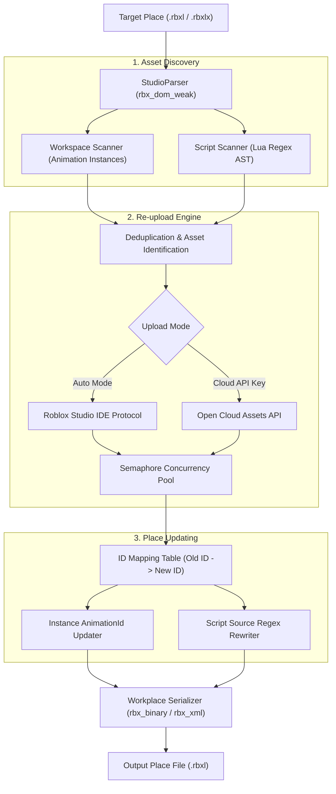

# 🎭 Roblox Animation Replacer (Modified & Enhanced)

<div align="center">

[](https://github.com/fin4j1881-blip/animation-replacer-roblox-modified/actions/workflows/ci.yml)
[](https://opensource.org/licenses/MIT)
[](https://www.rust-lang.org/)
[](https://tauri.app/)
[](https://www.roblox.com/)

**High-performance bulk Roblox animation scraper, re-uploader, and place code replacer.**  
*Available as both an ultra-light modern Desktop GUI (Tauri 2) and a blazing-fast CLI.*

[English](#-overview) • [Türkçe](#-t%C3%BCrk%C3%A7e-rehber) • [Architecture](#-architecture) • [Enhancements](#-enhancements-over-original) • [CLI Guide](#-cli-usage) • [GUI Guide](#-desktop-gui) • [Credits](#-credits--acknowledgements)

</div>

> [!NOTE]  
> This project is an enhanced, highly-optimized version based on the original foundation by [shibahex/animation-replacer-roblox](https://github.com/shibahex/animation-replacer-roblox). Special thanks to **@shibahex** for creating the original tool!

---

## 🌟 Key Features

- ⚡ **Auto-Mode (Roblox Studio Direct)**: Automatically reads your logged-in `.ROBLOSECURITY` cookie directly from Windows Credential Manager and uploads animations via Studio protocol — **no Open Cloud API Key required!**
- 🌐 **11 Languages Built-in**: Full dynamic internationalization (English, Türkçe, Español, Português, Deutsch, Français, Русский, 日本語, 한국어, 简体中文, and العربية with full RTL layout support).
- 🚀 **Extreme Concurrency & Performance**:
  - Tokio asynchronous runtime with configurable semaphore thread limits (`--threads`).
  - Memory-efficient zero-copy buffer parsing with `ustr` property string interning.
  - Regex precompilation via `std::sync::LazyLock` for zero runtime overhead.
  - Persistent place ID cache to avoid redundant API lookups.
- 🛡️ **Safe & Intelligent Script Rewriting**:
  - Replaces animation IDs inside `rbxassetid://`, `roblox.com/asset/?id=`, and raw string formats.
  - Optional `--unformatted-ids` scanner to catch bare numeric literals without corrupting longer IDs.
  - `--keep-names` preserves original animation titles instead of generic names.
  - `--dry-run` inspection mode scans and reports without touching files or spending upload quota.
- 🖥️ **Ultra-lightweight Desktop App**: Built on **Tauri 2**, uses native OS WebViews (~11 MB executable, low RAM footprint).

---

## 🔄 Enhancements Over Original

Compared to the upstream project ([shibahex/animation-replacer-roblox](https://github.com/shibahex/animation-replacer-roblox)), this modified repository includes:

1. **Modern Tauri 2 Desktop GUI**: Native dark-mode desktop application with Windows file pickers, live stat counters, and real-time process logging.
2. **Auto-Mode Integration**: Reads Windows Credential Manager to find logged-in Roblox Studio sessions and uploads via Studio direct protocol (`https://www.roblox.com/ide/publish/UploadNewAnimation`) without needing Open Cloud credentials.
3. **Multi-Language Engine**: Seamless in-app language switching across 11 languages with RTL support for Arabic and browser locale auto-detection.
4. **Deep Engine Optimizations (Rust 2024)**:
   - Zero-copy buffer parsing for large `.rbxl` files.
   - Fast hash lookups via `ustr` string interning.
   - Regex precompilation via `LazyLock` avoiding per-script compilation.
   - Concurrency safety with `RwLock` and `JoinSet`.
5. **CI/CD Pipeline**: GitHub Actions workflows for continuous integration and automated multi-OS release binary packaging (Windows `.exe`, Linux, macOS).

---

## 🏗 Architecture



---

## 🖥 Desktop GUI

The easiest way to use the application without typing command-line flags.

### Launching the GUI
- **Windows**: Double-click `Baslat-Arayuz.bat` or run:
  ```bash
  .\target\release\animation-replacer-gui.exe
  ```
- **From Source**:
  ```bash
  cargo run --release -p animation-replacer-gui
  ```

### GUI Highlights:
1. **Auto-Mode Switch**: Detects your Windows Roblox Studio login automatically.
2. **File Pickers**: Native OS dialogs to select `.rbxl`/`.rbxlx` files and set custom output targets.
3. **Language Dropdown**: Switch between 11 languages instantly from the header.
4. **Interactive Log Console**: Color-coded real-time output with one-click copy and clear.
5. **Live Progress Bars**: Real-time counter of animations found, audios identified, and replacement stages.

---

## 💻 CLI Usage

### Clone & Build from Source
Ensure [Rust & Cargo](https://rustup.rs/) are installed:
```bash
git clone https://github.com/fin4j1881-blip/animation-replacer-roblox-modified.git
cd animation-replacer-roblox-modified
cargo build --release
```
The compiled binary will be located at `target/release/animation-replace-roblox.exe`.

### Basic Usage (Direct Cookie)
```bash
animation-replace-roblox --file "Game.rbxl" --cookie "YOUR_COOKIE" --output "Game_Fixed.rbxl"
```

### Usage with Open Cloud API Key
```bash
animation-replace-roblox --file "Game.rbxl" --cookie "YOUR_COOKIE" --api-key "API_KEY" --output "Game_Fixed.rbxl"
```

### Uploading to a Roblox Group
```bash
animation-replace-roblox --file "Game.rbxl" --cookie "YOUR_COOKIE" --group 12345678 --output "Game_Fixed.rbxl"
```

### CLI Command Flags
| Flag | Short | Description |
| :--- | :---: | :--- |
| `--file <PATH>` | `-f` | **(Required)** Path to target `.rbxl` or `.rbxlx` place file. |
| `--cookie <STRING>` | `-c` | `.ROBLOSECURITY` cookie for authentication. |
| `--api-key <STRING>` | `-a` | *(Optional)* Open Cloud API Key. If omitted, uses Studio Direct Upload. |
| `--output <PATH>` | `-o` | *(Optional)* Output place path. If omitted, safely asks or overwrites. |
| `--group <ID>` | `-g` | *(Optional)* Roblox Group ID to upload animations to. |
| `--threads <NUM>` | `-t` | Max concurrent worker tasks (default: `10`). |
| `--unformatted-ids` | `-u` | Scans bare 6+ digit numbers in scripts besides `rbxassetid://`. |
| `--keep-names` | `-k` | Preserves original animation titles instead of generic names. |
| `--dry-run` | `-d` | Scans and lists animations without uploading or modifying place. |

---

## 🇹🇷 Türkçe Rehber

### Nedir?
Roblox Animation Replacer, başka hesaplara veya gruplara ait olan ve haritanızda çalışmayan 3. parti animasyonları otomatik olarak tespit eder, hesabınıza (veya grubunuza) yeniden yükler ve haritadaki tüm script ve Animation nesnelerini yeni ID'lerle günceller.

Bu sürüm, **shibahex** tarafından yazılan orijinal projenin derinlemesine optimize edilmiş, masaüstü arayüzü (Tauri 2), otomatik Roblox Studio tespiti ve çok dilli destek eklenmiş gelişmiş versiyonudur.

### Öne Çıkanlar
- **⚡ Otomatik Mod**: Bilgisayarınızda açık olan Roblox Studio oturumunu Windows Credential Manager'dan otomatik okur. API anahtarı almanıza gerek kalmadan doğrudan Studio protokolü ile animasyonları yükler.
- **🌐 11 Dil Desteği**: Arayüz sağ üst köşesinden Türkçe, İngilizce, İspanyolca, Rusça, Japonca vb. diller arasında anında geçiş yapabilirsiniz.
- **🛡️ Güvenli İşlem**: `--dry-run` ile dosyayı değiştirmeden önce nelerin değişeceğini listeleyebilir, `--output` ile orijinal haritanızı koruyabilirsiniz.
- **🚀 Ultra Hızlı**: Rust ve Tauri 2 altyapısıyla saniyeler içinde binlerce animasyonu eşzamanlı işleyebilir.

### Hızlı Başlangıç (GUI)
1. Proje dizinindeki `Baslat-Arayuz.bat` dosyasına çift tıklayın.
2. Otomatik Mod açıkken harita dosyanızı (`.rbxl` veya `.rbxlx`) seçin.
3. **"Animasyonları Değiştir"** butonuna basın.

---

## 🔒 Security & Privacy Notice

> [!WARNING]
> Your `.ROBLOSECURITY` cookie grants full administrative access to your Roblox account.
> - **Never share your cookie with anyone.**
> - This application runs **100% locally on your machine**. Your cookie and credentials are never transmitted to any third-party server — only directly to official `roblox.com` endpoints.
> - For maximum safety in production workflows, you may use an alternate account with developer permissions in your Roblox Group.

---

## 🛠 Tech Stack

- **Core Engine**: [Rust](https://www.rust-lang.org/) (2024 Edition)
- **Roblox DOM**: [rbx_dom_weak](https://github.com/rojo-rbx/rbx-dom), [rbx_binary](https://github.com/rojo-rbx/rbx-dom), [rbx_xml](https://github.com/rojo-rbx/rbx-dom)
- **Roblox API**: [Roboat](https://github.com/fekie/roboat)
- **Desktop Frontend**: [Tauri 2](https://tauri.app/) (Vanilla JS, CSS3, zero external web dependencies)
- **Async Runtime**: [Tokio](https://tokio.rs/) & [Reqwest](https://docs.rs/reqwest)

---

## 🤝 Credits & Acknowledgements

- **Original Author & Project**: [@shibahex](https://github.com/shibahex) — Creator of the original [animation-replacer-roblox](https://github.com/shibahex/animation-replacer-roblox).
- **Modified & Developed by**: [@fin4j1881-blip](https://github.com/fin4j1881-blip) — Enhancements, Tauri 2 GUI, Studio Auto-Mode, 11 languages i18n, performance optimizations, and CI/CD pipelines.
- **Roblox API Wrapper**: [Roboat](https://github.com/fekie/roboat)
- **Roblox DOM**: [rojo-rbx/rbx-dom](https://github.com/rojo-rbx/rbx-dom)
- **Desktop Framework**: [Tauri](https://tauri.app/)

---

## 📄 License

Distributed under the **MIT License**. See [`LICENSE`](LICENSE) for more information.
